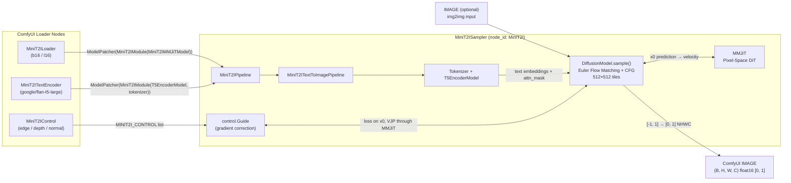

# MiniT2I-ComfyUI Architecture

`MiniT2I-ComfyUI` is a ComfyUI custom node pack that integrates the **MiniT2I** (`MiniT2I/MiniT2I`) pixel-space flow-matching text-to-image model into ComfyUI using the ComfyUI v3 node API (`comfy_api.latest`). Besides text-to-image it supports image-to-image, tiled sampling of images larger than 512 × 512, and training-free edge / depth / normal control.

---

## Repository Structure

| File | Responsibility |
| --- | --- |
| `__init__.py` | ComfyUI extension entry point (`comfy_entrypoint` → `MiniT2IExtension`) registering all custom nodes. |
| `MiniT2I.py` | ComfyUI node definitions (`MiniT2ITextEncoder`, `MiniT2ILoader`, `MiniT2ISampler`, `MiniT2IControl`), the `MiniT2IModule` wrapper and `ModelPatcher` integration. |
| `pipeline.py` | Self-contained model implementation (`MMJiT`, `DiffusionModel` with tiling and guidance hooks), Diffusers wrappers (`MiniT2IMMJiTModel`, `MiniT2IFlowMatchScheduler`), and inference pipelines (`MiniT2ITextToImagePipeline`, `MiniT2IPipeline`). |
| `control.py` | Control losses (`EdgeControl`, `DepthControl`, `NormalControl`) and the `Guide` that turns them into a sampling correction. |
| `temporal.py` | Optical-flow estimation (OpenCV DIS with pure-PyTorch multi-scale Lucas-Kanade fallback), forward-backward occlusion masks, variance-preserving 2× sub-pixel noise warping, early-step $x_0$ velocity anchoring, and post-sampling motion-compensated bilateral stabilization. |
| `example_workflows/MiniT2I_example.json` | Reference text-to-image workflow connecting the loaders, sampler, and `PreviewImage`. |
| `pyproject.toml` | Package metadata and Comfy Registry (`[tool.comfy]`) configuration. |
| `.github/workflows/publish.yml` | Publishes the pack to the Comfy Registry. |

---

## High-Level Data Flow

---

## 1. ComfyUI Extension & Nodes (`__init__.py`, `MiniT2I.py`)

`__init__.py` exposes an async `comfy_entrypoint()` returning `MiniT2IExtension(ComfyExtension)`, which registers four `io.ComfyNode` classes under the `MiniT2I` category.

`MiniT2IModule(torch.nn.Module)` wraps the Transformers/Diffusers models (and the tokenizer for the text encoder) before they go into `ModelPatcher`, because `ModelPatcher` assigns `.device`, which is a read-only property on those models. Nodes reach the real models through `patcher.model.module` and `patcher.model.tokenizer`.

### `MiniT2ITextEncoder` (`MiniT2I Text Encoder Loader`)
- **Inputs:** None
- **Outputs:** `MODEL`
- **Behavior:** Loads `google/flan-t5-large` as a `transformers.T5EncoderModel` in `torch.float32` plus its `AutoTokenizer`, and wraps both in `ModelPatcher(MiniT2IModule(text_encoder, tokenizer), mm.text_encoder_device(), mm.text_encoder_offload_device())`.

### `MiniT2ILoader` (`MiniT2I Model Loader`)
- **Inputs:** `model_type` (`Combo`: `"b16"` or `"l16"`)
- **Outputs:** `MODEL`
- **Behavior:** Calls `MiniT2IPipeline.load_transformer(model_type)`, which resolves the variant directory (`minit2i-b-16` or `minit2i-l-16`), downloads only `{model_dir}/transformer/*` and `{model_dir}/scheduler/*` from `MiniT2I/MiniT2I`, and loads `MiniT2IMMJiTModel` in `torch.bfloat16`. The result is wrapped in `ModelPatcher(MiniT2IModule(transformer), mm.get_torch_device(), mm.unet_offload_device())`.

### `MiniT2IControl` (`MiniT2I Control`)
- **Inputs:**
  - `image` (`Image`): the control map. Edge: white lines on black (Canny, Lineart, HED). Depth: near = white. Normal: ControlNet/BAE convention.
  - `control_type` (`Combo`: `edge`, `depth`, `normal`)
  - `strength` (`Float`, default `0.4`, range `0.0–4.0`)
  - `start` / `end` (`Float`, defaults `0.0` / `0.5`): the timestep window where guidance applies.
  - `control` (`MINIT2I_CONTROL`, optional): a previous control to chain.
- **Outputs:** `MINIT2I_CONTROL`, a custom `io.Custom("MINIT2I_CONTROL")` type holding a list of dicts (`type`, `image`, `strength`, `start`, `end`, and `depth_model` for depth/normal).
- **Behavior:** Appends one entry to the incoming list. For `depth` and `normal` it loads `depth_anything_3_small.safetensors` from the `geometry_estimation` model folder via `comfy.sd.load_diffusion_model`.

### `MiniT2ISampler` (`node_id="MiniT2I"`, `MiniT2I Sampler`)
- **Inputs:**
  - `prompt` (`String`, multiline)
  - `steps` (`Int`, default `10`, range `0–4096`)
  - `guidance` (`Float`, default `2.5`, range `0.0–100.0`)
  - `model` (`MODEL`, from `MiniT2ILoader`)
  - `text_encoder` (`MODEL`, from `MiniT2ITextEncoder`)
  - `seed` (`Int`, default `1`)
  - `denoise` (`Float`, default `1.0`, range `0.0–1.0`)
  - `image` (`Image`, optional): img2img input
  - `tile_overlap` (`Int`, default `64`, range `0–256`, step `8`)
  - `tile_batch_size` (`Int`, default `4`, range `1–64`, step `1`)
  - `temporal_consistency` (`Float`, default `0.0`, range `0.0–1.0`, step `0.05`)
  - `shared_noise` (`Float`, default `0.0`, range `0.0–1.0`, step `0.05`)
  - `flow_consistency` (`Float`, default `0.0`, range `0.0–1.0`, step `0.05`)
  - `control` (`MINIT2I_CONTROL`, optional)
- **Outputs:** `IMAGE`
- **Behavior:**
  1. Seeds PyTorch via `torch.manual_seed(seed)`; sampling noise comes from the global RNG.
  2. Calls `mm.load_models_gpu` on the transformer, the text encoder, and any depth models in `control`.
  3. With an `image`: drops alpha, converts to NCHW, upscales bilinearly (`comfy.utils.common_upscale`) so the short side is at least `image_size` (512), rescales to `[-1, 1]`, and casts to the transformer's device and dtype. The image batch size becomes `num_images_per_prompt`.
  4. With `control`: builds a `control.Guide` at the canvas size (the image size, or 512 × 512 without an image).
  5. Creates a `comfy.utils.ProgressBar`. Its callback checks `mm.throw_exception_if_processing_interrupted()` and updates the bar after each tile batch evaluation.
  6. Runs `MiniT2IPipeline()(prompt, transformer, text_encoder, tokenizer, model_dir=transformer.config._name_or_path.parent, ...)` with `output_type="pt"` and returns `output.images`.

---

## 2. Model Architecture (`pipeline.py`)

MiniT2I is a **pixel-space Multimodal Diffusion Transformer (`MMJiT`)**; there is no VAE. Each forward pass works on a `3 × 512 × 512` RGB tile split into `16 × 16` patches (`32 × 32 = 1024` image tokens).

### Configuration (`MMJiTConfig`)
Default (`b16`) configuration:
- Image: `image_size=512`, `patch_size=16`, `in_channels=3`, `pca_channels=128`
- Transformer: `hidden_size=768`, `txt_hidden_size=768`, `cond_vec_size=768`, `depth_double=17`, `txt_preamble_depth=2`, `num_heads=12`, `head_dim=64`, `mlp_ratio=2.6667`
- Text: `llm="google/flan-t5-large"`, `txt_input_size=1024`, `prompt_length=256`
- Sampling: `n_T=100`, `prediction="x"`, `sampler="euler"`, `cfg_interval=(0.0, 1.0)`

### Network Components (`MMJiT`)
1. **Image Embedding (`BottleneckPatchEmbed` + 2D SinCos PosEmbed):**
   - Two-stage convolutional patch projection: `Conv2d(3 → pca_channels, k=16, s=16)` followed by `Conv2d(pca_channels → hidden_size, k=1, s=1)`.
   - Flattens spatial patches into `(B, 1024, hidden_size)` and adds fixed 2D sinusoidal positional embeddings (`get_2d_sincos_pos_embed`).
2. **Text & Timestep Conditioning:**
   - Masked text positions (`attn_mask <= 0.5`) are replaced with a learned `mask_token`.
   - Text embeddings are projected via `txt_embedder` (`Linear(1024 → txt_hidden_size)`).
   - Timesteps are embedded via sinusoidal frequencies + 2-layer SiLU MLP (`TimestepEmbedder`) and summed with mean-pooled text projected by `pooled_embedder` into `vec`.
3. **Text Preamble (`PlainTextTransformerBlock` × `txt_preamble_depth`):**
   - Pre-`RMSNorm` self-attention with Q/K `RMSNorm`, 1D RoPE (`TextRotaryEmbedding1D`), and `SwiGLUMlp`.
4. **Joint Multimodal Backbone (`DoubleStreamDiTBlock` × `depth_double`):**
   - Dual-stream blocks with separate norms, QKV projections, output projections, and `SwiGLUMlp`s for image and text streams.
   - Shared Q/K `RMSNorm` and joint attention over concatenated `[txt, img]` sequences using `MultiModalRotaryEmbeddingFast` (1D RoPE on text tokens, 2D RoPE via `VisionRotaryEmbeddingFast` on the square image token grid).
   - Attention is computed with `torch.nn.functional.scaled_dot_product_attention`. When `temporal_consistency > 0` on multi-frame batches (`B > 1`), cross-frame attention runs on all blocks except the final `min(3, depth // 4)` high-frequency blocks and cosine-tapers to `0` by 70% sampling progress. Frame `f - 1`'s pre-RoPE K/V tokens are warped on the `32 × 32` patch grid via `temporal.build_tile_flow_grids` (when `flow_consistency > 0`) before applying 2D RoPE so attention tracks motion rather than screen position; the unwarped frame-`0` anchor is included at 20% of the cross-frame weight (vs. 80% for `prev`) only during the first 40% of steps to stabilize global palette without stamping frame-0 spatial textures. All weights conserve total image-vs-text softmax mass and preserve exact identity on frame `0`.
5. **Output Head (`FinalLayer` + `unpatchify`):**
   - Applies `RMSNorm` and a linear projection to `patch_size * patch_size * out_channels` directly on the image tokens, and reshapes back to `(B, 3, H, W)`.

### Flow Matching & Sampling (`DiffusionModel`)
Time runs from $t = 0$ (noise) to $t = 1$ (clean image).
- **x-Prediction to Velocity (`pred_velocity`):** Predicts the clean image $x_0 = \text{MMJiT}(x_t, t, \text{text}, \text{mask})$ and derives velocity:
  $$v = \frac{x_0 - x_t}{\max(1 - t,\; 0.001)}$$
- **Classifier-Free Guidance (`cfg_velocity`):** Concatenates conditional (`mask`) and unconditional (`zeros_like(mask)`) batches into a single forward pass and applies `uncond + (cond - uncond) * cfg_scale` for timesteps inside `cfg_interval`.
- **Tiling (`tile_starts`, `tile_weights`, `tiled_cfg_velocity`):** The canvas is covered by `image_size × image_size` tiles spread evenly so neighbours overlap by at least `tile_overlap` pixels. Each tile gets a separable linear-ramp window, normalized so the windows sum to 1 at every pixel. Tiles are evaluated in balanced batches of up to `max(1, tile_batch_size // B)` tiles per forward pass (with OOM-adaptive batch halving) and blended back with `addcmul_`. A 512 × 512 canvas takes a direct single-tile fast path with no blending buffer.
- **Image-to-Image:** `t_start = 1 - denoise`. With an input image the initial state is `lerp(noise, image, t_start)`.
- **Euler Integrator (`sample`):** Initializes noise as `torch.randn(...) * 2` at the canvas size (optionally correlating noise across frames when `shared_noise > 0` and `B > 1` — using static shared noise if `flow_consistency == 0`, or 2× sub-pixel optical-flow-warped noise via `temporal.warp_noise_sequence` when `flow_consistency > 0`), precomputes the text preamble (`MMJiT.prepare_text`) once for conditional and unconditional conditioning, and integrates from $t_\text{start}$ to $1.0$ over `n_T` uniform Euler steps:
  $$x_{t_{i+1}} = x_{t_i} + (t_{i+1} - t_i) \cdot v$$
  When `flow_consistency > 0` on multi-frame image batches, `temporal.anchor_x0_velocity` additionally anchors early-step full-canvas $x_0$ predictions across consecutive frames along the backward optical flow (masked by forward-backward occlusion confidence and cosine-tapered to `0` at 65% progress so final steps sharpen cleanly), followed by a post-sampling motion-compensated bilateral filter (`temporal.temporal_bilateral_stabilize`) to damp residual high-frequency pixel shimmer without blurring moving edges.
- **Control Guidance:** When a `Guide` is active at the current $t$, `sample` reuses the tiled conditional $x_0$ from `tiled_cfg_velocity(..., return_x0=True)` and subtracts `guide.correction(...) / max(1 - t, 0.001)` from $v$. The correction is pulled back to $x_t$ through `tiled_x0_vjp`, which runs `torch.func.functional_call` over a per-call detached clone of the network parameters and precomputed text preamble, one tile at a time, so activations are never held for the whole canvas.

---

## 3. Control Guidance (`control.py`)

Control is training-free gradient guidance on the model's $x_0$ prediction; there is no ControlNet.

- **`EdgeControl`:** Grayscale, 4× downscale (Gaussian blur + stride, which also differentiates on MPS), Sobel magnitude, blur (`σ = 1.5`). The loss is the negative Pearson correlation with the blurred target edge map. Comparing at reduced resolution moves shapes instead of drawing lines.
- **`DepthControl`:** Runs Depth Anything 3 (`comfy.ldm.depth_anything_3`) on the $x_0$ prediction at `compute_target_size(..., 504)` with ImageNet normalization, via `functional_call` on cloned parameters. The loss is the negative correlation of `-depth` with the target, so it ignores the target's depth scale and offset.
- **`NormalControl`:** Uses the same depth estimate and compares the Sobel slopes of the blurred `-depth` with the target's R/G channels (mapped to `[-1, 1]`, blurred `σ = 2`).
- **`Guide`:** Resizes each control map to the canvas, builds its control class under `torch.inference_mode(False)`, and is active when any control's `[start, end]` window contains $t$. `correction()`:
  1. Differentiates each active loss at the float32 $x_0$ and normalizes the gradient by its RMS times `strength`.
  2. Pulls the summed gradient back to $x_t$ with the model VJP.
  3. Averages it over channels, so guidance moves brightness rather than hue, and rescales it to the RMS of the $x_0$ gradient.

---

## 4. Diffusers & Pipeline Wrappers (`pipeline.py`)

- **`MiniT2IFlowMatchScheduler`** (`SchedulerMixin`, `ConfigMixin`): Stores timestep schedule configuration (`lognorm` / `uniform` training schedules and linear inference timesteps). At inference only its default `num_inference_steps` is used.
- **`MiniT2IMMJiTModel`** (`ModelMixin`, `ConfigMixin`): Diffusers-compatible wrapper around `DiffusionModel(MMJiTConfig)` supporting `.from_pretrained()` / `.save_pretrained()`. State-dict keys are `model.net.*`.
- **`MiniT2ITextToImagePipeline`** (`nn.Module`):
  - Tokenizes prompts with `padding="max_length"`, `truncation=True` and `max_length=prompt_length`, then encodes them.
  - Temporarily sets `cfg.n_T` to `num_inference_steps` and restores it in a `finally`.
  - Casts text embeddings and mask to the transformer dtype and calls `transformer.sample()` with the image, denoise, tiling, callback and guide arguments.
  - `output_type="pt"` (used by ComfyUI): clamps to `[-1, 1]`, rescales to `[0, 1]`, permutes to `(B, H, W, C)`, and casts to `float16` on CPU.
  - `output_type="pil"` / numpy: rescales to `uint8` `[0, 255]`.
  - Also has `from_pretrained()` / `save_pretrained()` for standalone use; the nodes don't call them.
- **`MiniT2IPipeline`** (`DiffusionPipeline`): Facade used by the nodes.
  - Maps variant aliases (`MODEL_ALIASES`: `b16`/`base` → `minit2i-b-16`, `l16`/`large` → `minit2i-l-16`).
  - Selectively downloads model subdirectories via `huggingface_hub.snapshot_download` and exposes `load_transformer()` for `MiniT2ILoader`.
  - `__call__(prompt, transformer, text_encoder, tokenizer, model_dir, **kwargs)` builds a `MiniT2ITextToImagePipeline` with the scheduler from `model_dir / "scheduler"` and runs it.
- **`build_transformer_from_checkpoint(ckpt_path)`**: Utility for loading raw `.pt` checkpoints (`{"config": ..., "state_dict": ...}`) into a `MiniT2IMMJiTModel`; the nodes don't use it.

---

## Notable Implementation Details

- **Device & dtype:**
  - The transformer runs in `bfloat16` and the text encoder in `float32`. Embeddings are cast to the transformer dtype before sampling.
  - Guidance losses run in `float32`.
  - `_encode_prompt` moves the text encoder to the transformer's device if they differ, outside `ModelPatcher`'s control.
- **Optional Inputs in `MiniT2ISampler`:** `model` and `text_encoder` are declared `optional=True`, yet `execute()` dereferences both. Both loader nodes must be connected.
- **`denoise` without an image:** the tooltip says it is only used with an image, but `sample` always starts at `t = 1 - denoise`. Values below 1 without an image start mid-schedule from pure noise.
- **Attention & Caching:**
  - `PlainTextTransformerBlock` and `DoubleStreamDiTBlock` use `torch.nn.functional.scaled_dot_product_attention` (SDPA) instead of materialized `einsum` + `softmax`.
  - 2D sinusoidal positional embeddings and 1D/2D RoPE `cos`/`sin` tables are cached in memory (created outside `inference_mode` so autograd in `tiled_x0_vjp` works cleanly).
  - `MMJiT.prepare_text` runs `txt_embedder`, `pooled_embedder`, and `txt_preamble_blocks` once per `sample()` call (for conditional and unconditional inputs) and reuses the result across all steps, tile batches, and VJP passes.
  - Loaded `ModelPatcher` instances for the transformer, text encoder, and Depth Anything 3 model, as well as the `MiniT2IFlowMatchScheduler` and the last 16 prompt embeddings, are cached in memory. On a prompt cache hit, the T5 text encoder does not need to be loaded onto GPU.
- **Cost per step:**
  - Each step evaluates tiles in balanced chunks of up to `max(1, tile_batch_size // B)` tiles, running one CFG pass (`2 × chunk × B` items) per chunk (or a single conditional pass when `guidance == 1.0` or outside `cfg_interval`).
  - Guided steps reuse the conditional $x_0$ from the CFG pass and add one VJP (forward + backward) per tile sequentially, plus the control losses (a Depth Anything 3 forward/backward for depth and normal).
- **Hub access:** `MiniT2ILoader` and `MiniT2ITextEncoder` try `local_files_only=True` first and only hit the Hugging Face Hub if the weights are not cached locally.
- **Conditioning Vector (`vec`):** `MMJiT.forward` computes `vec = t_vec + pooled_embedder(pooled_text)` and passes it to `DoubleStreamDiTBlock` and `FinalLayer`, which accept it without applying AdaLN modulation. `modulate()` is defined but unused.
