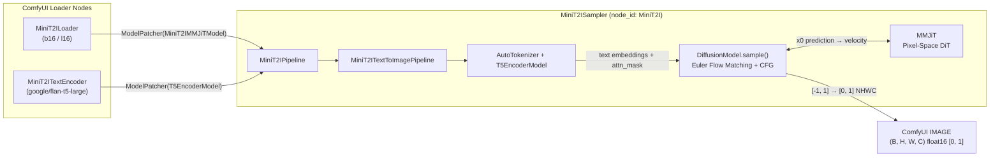

# MiniT2I-ComfyUI Architecture

`MiniT2I-ComfyUI` is a ComfyUI custom node pack that integrates the **MiniT2I** (`MiniT2I/MiniT2I`) pixel-space flow-matching text-to-image model into ComfyUI using the ComfyUI v3 node API (`comfy_api.latest`).

---

## Repository Structure

| File | Responsibility |
| --- | --- |
| `__init__.py` | ComfyUI extension entry point (`comfy_entrypoint` → `MiniT2IExtension`) registering all custom nodes. |
| `MiniT2I.py` | ComfyUI node definitions (`MiniT2ITextEncoder`, `MiniT2ILoader`, `MiniT2ISampler`) and `ModelPatcher` integration. |
| `pipeline.py` | Self-contained model implementation (`MMJiT`, `DiffusionModel`), Diffusers wrappers (`MiniT2IMMJiTModel`, `MiniT2IFlowMatchScheduler`), and inference pipelines (`MiniT2ITextToImagePipeline`, `MiniT2IPipeline`). |
| `example_workflows/MiniT2I_example.json` | Reference ComfyUI workflow connecting the loaders, sampler, and `PreviewImage`. |
| `pyproject.toml` | Package metadata and Comfy Registry (`[tool.comfy]`) configuration. |

---

## High-Level Data Flow

---

## 1. ComfyUI Extension & Nodes (`__init__.py`, `MiniT2I.py`)

`__init__.py` exposes an async `comfy_entrypoint()` returning `MiniT2IExtension(ComfyExtension)`, which registers three `io.ComfyNode` classes under the `MiniT2I` category:

### `MiniT2ITextEncoder` (`MiniT2I Text Encoder Loader`)
- **Inputs:** None
- **Outputs:** `MODEL`
- **Behavior:** Loads `google/flan-t5-large` as a `transformers.T5EncoderModel` in `torch.float32` and wraps it in `comfy.model_patcher.ModelPatcher(text_encoder, load_device, offload_device)` using `comfy.model_management`.

### `MiniT2ILoader` (`MiniT2I Model Loader`)
- **Inputs:** `model_type` (`Combo`: `"b16"` or `"l16"`)
- **Outputs:** `MODEL`
- **Behavior:** Calls `MiniT2IPipeline.load_transformer(model_type)`, which resolves the variant directory (`minit2i-b-16` or `minit2i-l-16`), downloads only `{model_dir}/transformer/*` and `{model_dir}/scheduler/*` from `MiniT2I/MiniT2I`, loads `MiniT2IMMJiTModel` in `torch.bfloat16`, and wraps it in `ModelPatcher`.

### `MiniT2ISampler` (`node_id="MiniT2I"`, `MiniT2I Sampler`)
- **Inputs:**
  - `prompt` (`String`, multiline)
  - `steps` (`Int`, default `10`, range `0–4096`)
  - `guidance` (`Float`, default `2.5`, range `0.0–100.0`)
  - `model` (`MODEL`, from `MiniT2ILoader`)
  - `text_encoder` (`MODEL`, from `MiniT2ITextEncoder`)
  - `seed` (`Int`, default `1`)
- **Outputs:** `IMAGE`
- **Behavior:**
  1. Seeds PyTorch via `torch.manual_seed(seed)`.
  2. Instantiates `MiniT2IPipeline.from_pretrained("MiniT2I/MiniT2I", local_files_only=model_downloaded)` and sets the module-level `model_downloaded = True` flag so subsequent executions skip remote Hub checks.
  3. Unwraps `model.model` and `text_encoder.model` from their `ModelPatcher` wrappers, derives `model_dir` from `model.model.config._name_or_path.parent`, and runs inference with `torch_dtype=torch.bfloat16` and `output_type="pt"`.
  4. Returns `output.images` as a ComfyUI `IMAGE` tensor.

---

## 2. Model Architecture (`pipeline.py`)

MiniT2I is a **pixel-space Multimodal Diffusion Transformer (`MMJiT`)**—there is no VAE. It operates directly on `3 × 512 × 512` RGB images split into `16 × 16` patches (`32 × 32 = 1024` image tokens).

### Configuration (`MMJiTConfig`)
Default (`b16`) configuration:
- Image: `image_size=512`, `patch_size=16`, `in_channels=3`, `pca_channels=128`
- Transformer: `hidden_size=768`, `txt_hidden_size=768`, `cond_vec_size=768`, `depth_double=17`, `txt_preamble_depth=2`, `num_heads=12`, `head_dim=64`, `mlp_ratio=2.6667`
- Text: `llm="google/flan-t5-large"`, `txt_input_size=1024`, `prompt_length=256`
- Sampling: `n_T=100`, `prediction="x"`, `sampler="euler"`, `cfg_interval=(0.0, 1.0)`

### Network Components (`MMJiT`)
1. **Image Embedding (`BottleneckPatchEmbed` + 2D SinCos PosEmbed):**
   - Two-stage convolutional patch projection: `Conv2d(3 → pca_channels, k=16, s=16)` followed by `Conv2d(pca_channels → hidden_size, k=1, s=1)`.
   - Flattens spatial patches into `(B, 1024, hidden_size)` and adds fixed 2D sinusoidal positional embeddings (`get_2d_sincos_pos_embed`).
2. **Text & Timestep Conditioning:**
   - Masked text positions (`attn_mask <= 0.5`) are replaced with a learned `mask_token`.
   - Text embeddings are projected via `txt_embedder` (`Linear(1024 → txt_hidden_size)`).
   - Timesteps are embedded via sinusoidal frequencies + 2-layer SiLU MLP (`TimestepEmbedder`) and summed with mean-pooled text projected by `pooled_embedder`.
3. **Text Preamble (`PlainTextTransformerBlock` × `txt_preamble_depth`):**
   - Pre-`RMSNorm` self-attention with Q/K `RMSNorm`, 1D RoPE (`TextRotaryEmbedding1D`), and `SwiGLUMlp`.
4. **Joint Multimodal Backbone (`DoubleStreamDiTBlock` × `depth_double`):**
   - Dual-stream blocks with separate norms, QKV projections, output projections, and `SwiGLUMlp`s for image and text streams.
   - Shared Q/K `RMSNorm` and joint attention over concatenated `[txt, img]` sequences using `MultiModalRotaryEmbeddingFast` (1D RoPE on text tokens, 2D RoPE via `VisionRotaryEmbeddingFast` on the square image token grid).
5. **Output Head (`FinalLayer` + `unpatchify`):**
   - Applies `RMSNorm` and a linear projection to `patch_size * patch_size * out_channels`, slices out the image tokens, and reshapes back to `(B, 3, H, W)`.

### Flow Matching & Sampling (`DiffusionModel`)
- **x-Prediction to Velocity (`pred_velocity`):** Predicts clean image $x_0 = \text{MMJiT}(x_t, t, \text{text}, \text{mask})$ and derives velocity:
  $$v = \frac{x_0 - x_t}{\max(1 - t,\; 0.001)}$$
- **Classifier-Free Guidance (`cfg_velocity`):** Concatenates conditional (`mask`) and unconditional (`zeros_like(mask)`) batches into a single forward pass, applying `uncond + (cond - uncond) * cfg_scale` for timesteps inside `cfg_interval`.
- **Euler Integrator (`sample`):** Initializes noise as `torch.randn(...) * 2` and integrates linearly from $t = 0.0$ to $t = 1.0$ over `n_T` uniform Euler steps:
  $$x_{t_{i+1}} = x_{t_i} + (t_{i+1} - t_i) \cdot v$$

---

## 3. Diffusers & Pipeline Wrappers (`pipeline.py`)

- **`MiniT2IFlowMatchScheduler`** (`SchedulerMixin`, `ConfigMixin`): Stores timestep schedule configuration (`lognorm` / `uniform` training schedules and linear inference timesteps).
- **`MiniT2IMMJiTModel`** (`ModelMixin`, `ConfigMixin`): Diffusers-compatible wrapper around `DiffusionModel(MMJiTConfig)` supporting `.from_pretrained()` / `.save_pretrained()`.
- **`MiniT2ITextToImagePipeline`** (`nn.Module`): Orchestrates Flan-T5 tokenization (`padding="max_length"`, `max_length=cfg.prompt_length`), text encoding, `transformer.sample()`, and image post-processing:
  - `output_type="pt"` (used by ComfyUI): clamps to `[-1, 1]`, rescales to `[0, 1]`, permutes to `(B, H, W, C)`, casts to `float16` on CPU.
  - `output_type="pil"` / numpy: rescales to `uint8` `[0, 255]`.
- **`MiniT2IPipeline`** (`DiffusionPipeline`): Facade that maps variant aliases (`MODEL_ALIASES`: `b16`/`base` → `minit2i-b-16`, `l16`/`large` → `minit2i-l-16`), selectively downloads model subdirectories via `huggingface_hub.snapshot_download`, exposes `load_transformer()` for `MiniT2ILoader`, and accepts preloaded `transformer` and `text_encoder` instances in `__call__()`.
- **`build_transformer_from_checkpoint(ckpt_path)`**: Utility for loading raw `.pt` checkpoints (`{"config": ..., "state_dict": ...}`) into a `MiniT2IMMJiTModel`.

---

## Notable Implementation Details

- **VRAM & Device Management:** `MiniT2ILoader` and `MiniT2ITextEncoder` wrap their models in `ModelPatcher` for ComfyUI caching, but `MiniT2IPipeline.__call__` moves the assembled `MiniT2ITextToImagePipeline` directly via `pipe.to("cuda" if torch.cuda.is_available() else "cpu")` rather than invoking `comfy.model_management.load_models_gpu`.
- **Optional Inputs in `MiniT2ISampler`:** `model` and `text_encoder` are declared `optional=True` in `define_schema`, yet `execute()` accesses `model.model` and `text_encoder.model` directly; both loader nodes should be connected in workflows (as shown in `example_workflows/MiniT2I_example.json`).
- **Per-Run Overhead:** `MiniT2ISampler.execute` re-instantiates `MiniT2IPipeline`, reloads the scheduler config and Flan-T5 `AutoTokenizer` on each call, while reusing the cached `transformer` and `text_encoder` weights from the loader nodes.
- **Caching Flag:** `model_downloaded` in `MiniT2I.py` is set after the first sampler run and used by `MiniT2ITextEncoder` and `MiniT2ISampler`; `MiniT2ILoader` calls `MiniT2IPipeline.load_transformer` with its default `local_files_only=False`.
- **Conditioning Vector (`vec`):** `MMJiT.forward` computes `vec = t_vec + pooled_embedder(pooled_text)` and passes it to `DoubleStreamDiTBlock` and `FinalLayer`, where it is currently accepted as a parameter without applying AdaLN modulation.
